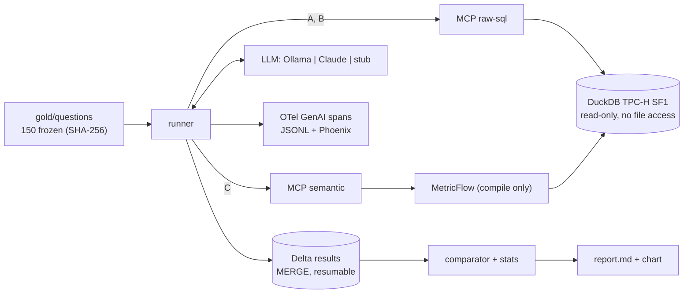

<div align="center">

**English** · [Português](README.pt-BR.md)

# Semantic Layer Agent Bench

**Does a semantic layer make text-to-SQL agents more accurate, or does good documentation do the same job?**

A controlled, reproducible benchmark. Local, one command, zero cloud cost.

</div>

---

## Why this exists

Most published comparisons pit an agent with the raw schema (A) against an agent with a
semantic layer (C). C wins, and the conclusion looks obvious. But C changes two variables at
once: it adds an abstraction layer **and** it adds the business definitions. Without an arm
that gets the definitions without the layer, you cannot tell which one moved the number.

This benchmark adds that arm:

| Arm | Agent sees | Tools (MCP) |
|---|---|---|
| **A** raw schema | the database | `list_tables`, `describe_table`, `run_sql` |
| **B** raw + glossary | the database **and** the business glossary as text | same as A |
| **C** semantic layer | governed metrics only (MetricFlow) | `list_metrics`, `list_dimensions`, `query_metrics` |

The glossary in B and the metric descriptions in C come from the same file
(`glossary/metrics.yaml`), and a test fails if they drift apart. If **B ≈ C**, the gain was
documentation. If **C ≫ B**, the layer pays for itself.

## Status

| Piece | State |
|---|---|
| Data, gold set, semantic layer, parity, harness, stats, report, CI | **Done and tested** (output below) |
| Results with real models (Ollama local, Claude API) | **Not run yet.** No number in this repo comes from a model |

I will not publish accuracy numbers until the runs exist. The commands to produce them are
under [Run the benchmark](#run-the-benchmark).

## What makes the result trustworthy

- **Questions frozen before the semantic layer was used for them.** 150 business questions
  were written by four independent writers from the glossary and pinned by SHA-256 in
  `gold/HASH` (commit `feat(slab): freeze gold set ...`). MetricFlow specs for the parity test came after. Every
  run records the hash and refuses to start if the gold set changed.
- **Parity test.** All 130 in-coverage questions are answered by the semantic layer with
  the same result as their reference SQL (`130/130`). Arm C can never lose because of my
  modeling bug.
- **Execution accuracy, not an LLM judge.** The submitted query is executed and compared
  with the reference result: order-insensitive unless asked, column names ignored, numeric
  tolerance, integer year ≡ January-1st date. The comparator is property-tested.
- **Same loop for every arm and provider.** Same system prompt, same limits (8 tool calls,
  60 s), temperature 0. Only the tools and, in B, the glossary change.
- **Holdout.** 50 dev / 100 holdout, stratified, assigned by hash of the question id. Only
  holdout numbers get published.
- **Statistics per question.** Attempts are averaged per question; 95% bootstrap CI
  resamples questions; paired exact McNemar between arms; the documentation share
  (B−A)/(C−A) with its own CI. An A/A test checks the harness for bias.
- **Out-of-coverage questions.** 12 are answerable from raw tables but not from the
  semantic layer (the right move in C is to refuse), 8 are not answerable at all.

## Architecture



Details and decision records: [docs/architecture.md](docs/architecture.md).

## Quick start

Requirements: Python 3.12, [uv](https://docs.astral.sh/uv/), `make`. About 1.5 GB of disk.

```bash
make install
```

```bash
make data gold-check parity test smoke
```

That generates TPC-H SF1 (6M order lines), builds the semantic layer, validates the frozen
gold set, runs parity, the 83 tests and a scripted end-to-end smoke run. No model, no
network, no API key. Real output from a clean run on 2026-11-05 (2 min 28 s on 4 vCPU):

```text
150 questions {'business_definition': 25, 'multi_join': 40, 'out_of_coverage': 20, 'simple': 40, 'time': 25}
sha256 2b8663f422b012acf5935e31f4ffd0d468e0552a93f9d0cda071f35676069f23
hash matches frozen gold set
OK
parity: 130/130 match
83 passed in 69.50s (0:01:09)
run smoke finished: 10 questions x 3 arms x 1
| stub-scripted-v1 | A raw schema | 10 | 70.0% | 40.0% – 100.0% | 70.0% |
| stub-scripted-v1 | B raw + glossary | 10 | 70.0% | 40.0% – 100.0% | 70.0% |
| stub-scripted-v1 | C semantic layer | 10 | 70.0% | 40.0% – 100.0% | 70.0% |
```

The smoke run uses a scripted stub that answers 7 of 10 questions correctly in every arm
through the real stdio MCP servers, so **70% is the expected value, not a result**. It proves
the pipeline end to end.

With Docker instead (not exercised in the build environment, which had no Docker daemon):

```bash
docker compose run --rm bench data
```

```bash
docker compose run --rm bench smoke
```

## Run the benchmark

**Local model (free).** Pull a model with native tool calling into Ollama, then:

```bash
make bench-ollama MODEL=<ollama tag> RUN=local-1
```

**Claude.** Copy `config/prices.example.yaml` to `config/prices.yaml` and fill in current
prices, so the budget guard works. Calibrate on the dev split with one attempt first:

```bash
ANTHROPIC_API_KEY=... .venv/bin/slab bench --provider anthropic --split dev --attempts 1 --budget-usd 5 --run-id claude-dev
```

Then the holdout:

```bash
ANTHROPIC_API_KEY=... make bench-claude BUDGET_USD=40 RUN=claude-1
```

**Report and A/A check:**

```bash
make report RUN="local-1 claude-1"
```

```bash
.venv/bin/slab aa local-1 local-2 --arm A
```

Runs are resumable: kill one and run the same command again; finished rows are skipped and
nothing is duplicated (tested with `kill -9`). Traces go to `runs/<run_id>/spans.jsonl` and,
with `OTEL_EXPORTER_OTLP_ENDPOINT` set, to Phoenix.

## Repository map

| Path | What |
|---|---|
| `glossary/metrics.yaml` | business definitions, the single source of truth |
| `gold/questions/` | 150 frozen questions with reference SQL |
| `gold/mf_specs/` | MetricFlow query per in-coverage question, used only by parity |
| `dbt/` | dbt-duckdb models and the MetricFlow semantic layer |
| `src/slab/servers/` | the two MCP servers |
| `src/slab/agent/` | loop, prompts, providers (Ollama, Anthropic, stub) |
| `src/slab/harness/` | runner, evaluator, Delta store, stats, report |
| `src/slab/db.py`, `sqlguard.py` | read-only connection and SQL policy |
| `docs/` | business case, requirements (ISO/IEC/IEEE 29148), architecture + ADRs, acceptance plan |

## Gotchas found while building it

- **`read_only=True` in DuckDB does not block `read_csv('/etc/passwd')`.** File access is a
  separate switch (`enable_external_access`), and an agent with SQL can flip it back with
  `SET` unless `lock_configuration` is set after it. Both are tested.
- **DuckDB has no statement timeout.** Queries run under a timer that calls `interrupt()`.
- **MCP 2.x hides tool exception text from the client** unless the tool raises `ToolError`.
  With a plain `ValueError` the agent only sees "Error executing tool", and can't fix its query.
- **MetricFlow needs a database handle just to compile SQL.** Pointing its dbt target at an
  in-memory DuckDB keeps it from locking the real file in read-write mode.
- **In TPC-H, returns only exist for orders before mid-1995.** Questions that test "net
  revenue excludes returns" have to use 1992–1995 or the trap does nothing.

## Limits

- TPC-H is public, so models may have seen the schema. A renamed-schema subset is on the roadmap.
- One semantic layer (MetricFlow), one glossary, one dataset.
- n = 100 holdout questions: differences under ~10–15 pp will probably not be significant.
- The Ollama and Anthropic providers have mocked translation tests but have not been run
  against live endpoints yet.

## Roadmap

- [ ] Runs: one local model and Claude, 3 attempts on the holdout
- [ ] Renamed-schema subset (contamination check)
- [ ] Arm D: semantic layer first, raw SQL fallback
- [ ] Arm C′: Databricks Metric Views

---

Built by [Otelmo Junior](https://github.com/OtelmoJr)
