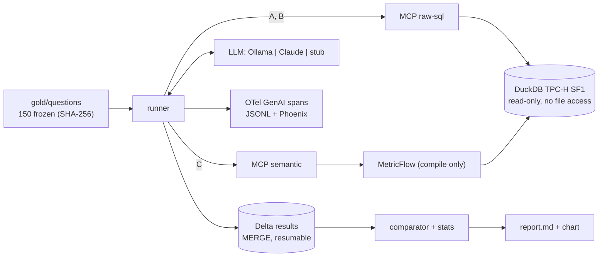

<div align="center">

[English](README.md) · **Português**

# Semantic Layer Agent Bench

**Um semantic layer deixa agentes de text-to-SQL mais precisos, ou uma boa documentação faz o mesmo trabalho?**

Um benchmark controlado e reproduzível. Local, um comando, custo zero de nuvem.

</div>

---

## Por que isso existe

A maioria das comparações publicadas coloca um agente com o schema cru (A) contra um agente com
semantic layer (C). C ganha, e a conclusão parece óbvia. Só que C muda duas variáveis ao
mesmo tempo: adiciona uma camada de abstração **e** adiciona as definições de negócio. Sem um braço
que receba as definições sem a camada, não dá para saber qual das duas mexeu no número.

Este benchmark adiciona esse braço:

| Braço | O agente vê | Tools (MCP) |
|---|---|---|
| **A** schema cru | o banco de dados | `list_tables`, `describe_table`, `run_sql` |
| **B** cru + glossário | o banco de dados **e** o glossário de negócio como texto | as mesmas de A |
| **C** semantic layer | apenas métricas governadas (MetricFlow) | `list_metrics`, `list_dimensions`, `query_metrics` |

O glossário em B e as descrições das métricas em C vêm do mesmo arquivo
(`glossary/metrics.yaml`), e um teste falha se os dois divergirem. Se **B ≈ C**, o ganho veio da
documentação. Se **C ≫ B**, a camada se paga.

## Status

| Peça | Estado |
|---|---|
| Dados, gold set, semantic layer, parity, harness, estatística, relatório, CI | **Pronto e testado** (saída abaixo) |
| Resultados com modelos reais (Ollama local, API do Claude) | **Ainda não rodado.** Nenhum número neste repositório vem de um modelo |

Não vou publicar números de acurácia enquanto as execuções não existirem. Os comandos para gerá-los
estão em [Rodando o benchmark](#run-the-benchmark).

## O que torna o resultado confiável

- **Perguntas congeladas antes de o semantic layer ser usado para elas.** 150 perguntas de negócio
  foram escritas por quatro autores independentes a partir do glossário e fixadas por SHA-256 em
  `gold/HASH` (commit `feat(slab): freeze gold set ...`). As specs de MetricFlow para o teste de parity vieram depois. Toda
  execução registra o hash e se recusa a começar se o gold set tiver mudado.
- **Teste de parity.** Todas as 130 perguntas dentro da cobertura são respondidas pelo semantic layer com
  o mesmo resultado do SQL de referência (`130/130`). O braço C nunca pode perder por causa de um bug
  na minha modelagem.
- **Execution accuracy, não LLM como juiz.** A query submetida é executada e comparada
  com o resultado de referência: sem considerar ordem, a não ser que a pergunta peça, nomes de colunas ignorados,
  tolerância numérica, ano inteiro ≡ data de 1º de janeiro. O comparador tem testes baseados em propriedades.
- **O mesmo loop para todo braço e todo provedor.** Mesmo system prompt, mesmos limites (8 chamadas de tool,
  60 s), temperatura 0. Só mudam as tools e, em B, o glossário.
- **Holdout.** 50 dev / 100 holdout, estratificado, atribuído por hash do id da pergunta. Só os
  números do holdout são publicados.
- **Estatística por pergunta.** As tentativas são agregadas por média em cada pergunta; o IC bootstrap de 95%
  reamostra perguntas; McNemar exato pareado entre braços; a parcela da documentação
  (B−A)/(C−A) com seu próprio IC. Um teste A/A verifica se o harness tem viés.
- **Perguntas fora da cobertura.** 12 podem ser respondidas a partir das tabelas cruas, mas não pelo
  semantic layer (em C, o certo é recusar), e 8 não podem ser respondidas de jeito nenhum.

## Arquitetura



Detalhes e registros de decisão: [docs/architecture.pt-BR.md](docs/architecture.pt-BR.md).

## Início rápido

Requisitos: Python 3.12, [uv](https://docs.astral.sh/uv/), `make`. Cerca de 1,5 GB de disco.

```bash
make install
```

```bash
make data gold-check parity test smoke
```

Isso gera o TPC-H SF1 (6M linhas de pedido), constrói o semantic layer, valida o gold set
congelado, roda o parity, os 83 testes e uma execução smoke ponta a ponta com script. Sem modelo, sem
rede, sem API key. Saída real de uma execução limpa em 2026-11-05 (2 min 28 s em 4 vCPU):

```text
150 questions {'business_definition': 25, 'multi_join': 40, 'out_of_coverage': 20, 'simple': 40, 'time': 25}
sha256 2b8663f422b012acf5935e31f4ffd0d468e0552a93f9d0cda071f35676069f23
hash matches frozen gold set
OK
parity: 130/130 match
83 passed in 69.50s (0:01:09)
run smoke finished: 10 questions x 3 arms x 1
| stub-scripted-v1 | A raw schema | 10 | 70.0% | 40.0% – 100.0% | 70.0% |
| stub-scripted-v1 | B raw + glossary | 10 | 70.0% | 40.0% – 100.0% | 70.0% |
| stub-scripted-v1 | C semantic layer | 10 | 70.0% | 40.0% – 100.0% | 70.0% |
```

A execução smoke usa um stub com script que acerta 7 de 10 perguntas em todos os braços,
passando pelos servidores MCP reais via stdio, então **70% é o valor esperado, não um resultado**. Ela prova
o pipeline de ponta a ponta.

Com Docker (não exercitado no ambiente de build, que não tinha daemon do Docker):

```bash
docker compose run --rm bench data
```

```bash
docker compose run --rm bench smoke
```

<a id="run-the-benchmark"></a>
## Rodando o benchmark

**Modelo local (grátis).** Baixe no Ollama um modelo com tool calling nativo e então:

```bash
make bench-ollama MODEL=<ollama tag> RUN=local-1
```

**Claude.** Copie `config/prices.example.yaml` para `config/prices.yaml` e preencha os preços
atuais, para que o controle de orçamento funcione. Calibre primeiro no split dev com uma tentativa:

```bash
ANTHROPIC_API_KEY=... .venv/bin/slab bench --provider anthropic --split dev --attempts 1 --budget-usd 5 --run-id claude-dev
```

Depois, o holdout:

```bash
ANTHROPIC_API_KEY=... make bench-claude BUDGET_USD=40 RUN=claude-1
```

**Relatório e verificação A/A:**

```bash
make report RUN="local-1 claude-1"
```

```bash
.venv/bin/slab aa local-1 local-2 --arm A
```

As execuções podem ser retomadas: mate uma e rode o mesmo comando de novo; as linhas já concluídas são puladas e
nada é duplicado (testado com `kill -9`). Os traces vão para `runs/<run_id>/spans.jsonl` e,
com `OTEL_EXPORTER_OTLP_ENDPOINT` definido, para o Phoenix.

## Mapa do repositório

| Caminho | O quê |
|---|---|
| `glossary/metrics.yaml` | definições de negócio, a única fonte da verdade |
| `gold/questions/` | 150 perguntas congeladas com SQL de referência |
| `gold/mf_specs/` | query MetricFlow por pergunta dentro da cobertura, usada só pelo parity |
| `dbt/` | modelos dbt-duckdb e o semantic layer em MetricFlow |
| `src/slab/servers/` | os dois servidores MCP |
| `src/slab/agent/` | loop, prompts, provedores (Ollama, Anthropic, stub) |
| `src/slab/harness/` | runner, avaliador, store Delta, estatística, relatório |
| `src/slab/db.py`, `sqlguard.py` | conexão read-only e política de SQL |
| `docs/` | business case, requisitos (ISO/IEC/IEEE 29148), arquitetura + ADRs, plano de aceite |

## Pegadinhas encontradas na construção

- **`read_only=True` no DuckDB não bloqueia `read_csv('/etc/passwd')`.** Acesso a arquivo é uma
  chave separada (`enable_external_access`), e um agente com SQL consegue religá-la com
  `SET`, a menos que `lock_configuration` seja ativado depois dela. As duas coisas estão testadas.
- **O DuckDB não tem statement timeout.** As queries rodam sob um timer que chama `interrupt()`.
- **O MCP 2.x esconde do cliente o texto da exceção da tool**, a menos que a tool lance `ToolError`.
  Com um `ValueError` comum, o agente só vê "Error executing tool" e não consegue corrigir a query.
- **O MetricFlow precisa de um handle de banco só para compilar SQL.** Apontar o target dbt dele para um
  DuckDB em memória evita que ele trave o arquivo real em modo leitura e escrita.
- **No TPC-H, devoluções só existem para pedidos anteriores a meados de 1995.** Perguntas que testam "receita
  líquida exclui devoluções" precisam usar 1992–1995, senão a armadilha não faz nada.

## Limitações

- O TPC-H é público, então os modelos podem já ter visto o schema. Um subconjunto com schema renomeado está no roadmap.
- Um único semantic layer (MetricFlow), um glossário, um dataset.
- n = 100 perguntas de holdout: diferenças abaixo de ~10–15 pp provavelmente não serão significativas.
- Os provedores Ollama e Anthropic têm testes de tradução com mocks, mas ainda não foram executados
  contra endpoints reais.

## Roadmap

- [ ] Execuções: um modelo local e o Claude, 3 tentativas no holdout
- [ ] Subconjunto com schema renomeado (checagem de contaminação)
- [ ] Braço D: semantic layer primeiro, fallback para SQL cru
- [ ] Braço C′: Databricks Metric Views

---

Feito por [Otelmo Junior](https://github.com/OtelmoJr)
