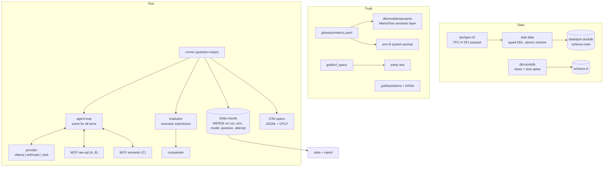

# Solution architecture

[Português](architecture.pt-BR.md)

## Components

### Request path of one attempt

1. The runner opens one MCP client per arm (stdio subprocess by default) and iterates
   question-major: all arms and attempts of a question before the next question, so model
   or machine drift affects arms equally.
2. The loop sends the question with the arm's system prompt and tools. Exploration tools
   come from MCP; `submit_sql` / `submit_metric_query` and `refuse` are terminal tools
   owned by the harness.
3. After 8 exploration calls the model gets one last turn with only the terminal tools.
4. The evaluator re-executes the submission with its own guarded connection (the agent
   cannot influence how it is graded), compares with the reference result and writes the
   row. Spans carry `gen_ai.*` attributes and the evaluation score.

### Security boundary

| Layer | Control | Test |
|---|---|---|
| Connection | `read_only=True`, `enable_external_access=false`, extension auto-install off, then `lock_configuration=true` | `tests/test_guards.py::TestConnection` |
| SQL policy | sqlglot parse: one SELECT/UNION, no DDL/DML/PRAGMA/SET/ATTACH/COPY, deny-listed table and scalar functions, table allow-list per arm | 21 rejection cases |
| Arm isolation | raw arms may read only `main.*` TPC-H tables; the semantic arm's compiled SQL may read only `sl.*` models | `test_contract.py`, `test_semantic_layer.py` |
| Runaway queries | 20 s timer calling `interrupt()`; 200-row cap on what the agent sees | `test_timeout_interrupts_runaway_query` |

## Decision records

### ADR-001 TPC-H via tpchgen-cli instead of TPC-DS

- **Context.** The plan used TPC-DS through DuckDB's `tpcds` extension. Extensions download
  from `extensions.duckdb.org`, which the build environment could not reach, and which
  would be a network dependency in every CI run.
- **Decision.** TPC-H SF1 generated by `tpchgen-cli` (a PyPI package, deterministic, ~4 s),
  loaded with explicit DDL so types cannot drift with the generator.
- **Consequences.** Fewer dimensions than TPC-DS (8 tables), so the semantic layer is
  smaller. Column names are still cryptic (`l_extendedprice`), which keeps arm A honest.
  The data has a quirk that matters for question design: returned lines only exist for
  orders before mid-1995.

### ADR-002 One thin agent loop instead of a vendor agent SDK

- **Context.** Two providers (local and hosted) must be compared fairly.
- **Decision.** One provider-neutral loop (`agent/loop.py`), providers only translate
  messages. Same limits, prompt and terminal tools everywhere.
- **Consequences.** Any accuracy difference between providers or arms cannot come from
  the harness. The trade-off is not showcasing a vendor SDK; one can be added later as a
  separate arm.

### ADR-003 Execution accuracy instead of LLM-as-judge

- **Decision.** Grade by executing the submission and comparing result sets.
- **Why.** A judge costs tokens, varies between runs and tends to accept a well written
  answer with a wrong number. Numbers are verifiable, so verify them.
- **Comparator rules** (all property-tested): multiset of rows unless the question is
  ordered; column names and order ignored; extra columns tolerated, missing ones not;
  relative tolerance 1e-4; midnight timestamp ≡ date; integer year ≡ January-1st date;
  NULL = NULL.

### ADR-004 Traces to local JSONL plus optional OTLP (Phoenix), not MLflow

- **Context.** The plan proposed MLflow Tracing with a spike to validate its OTLP intake.
- **Decision.** Spans always go to `runs/<run_id>/spans.jsonl` and, when
  `OTEL_EXPORTER_OTLP_ENDPOINT` is set, to an OTLP/HTTP collector. docker-compose ships
  Phoenix, which accepts OTLP natively.
- **Consequences.** Traces exist without any backend, and the e2e test checks that every
  result row's `trace_id` is in the trace file. MLflow can be pointed at the same OTLP
  endpoint later if its intake is validated.

### ADR-005 MetricFlow as a compiler only

- **Context.** MetricFlow's dbt adapter opens the DuckDB file in read-write mode, which
  conflicts with the read-only connection in the same process.
- **Decision.** MetricFlow runs against a dbt target backed by an in-memory DuckDB
  (`compile` in `dbt/profiles.yml`) and only produces SQL. Catalog qualifiers are stripped,
  and the SQL runs through the same guarded connection and a semantic-only table policy.
- **Consequences.** Arm C gets the same security boundary as A and B, and grading runs the
  same code path the agent used.

### ADR-006 Delta results table without partitioning

- **Decision.** delta-rs table, `MERGE` on `(run_id, arm, model_id, question_id, attempt)`,
  flushed every 10 attempts.
- **Why no partitions.** A full run is about 2.7k rows. Partitioning by run or date would
  only create small files. Revisit above ~10⁶ rows.
- **Consequences.** Re-running is a no-op, a killed run resumes where its last commit
  ended (tested with `kill -9`), and the table is readable by any Delta engine.

### ADR-007 Gold set provenance

- **Facts, stated plainly.** The glossary came first. Four independent writer agents wrote
  the 150 questions and reference SQL from the glossary and the raw schema, without
  access to any MetricFlow spec. While they worked, the semantic layer YAML was written
  from the glossary by a different author, who did not read the questions. The gold set
  was validated and frozen (commit `feat(slab): freeze gold set ...`) before any per-question MetricFlow spec
  existed. Specs were then written per question and must reproduce the reference result
  exactly (`parity: 130/130`).
- **Residual risk.** All authors were AI-assisted and worked from the same glossary.
  A human-written holdout extension is the best way to reduce this further.
