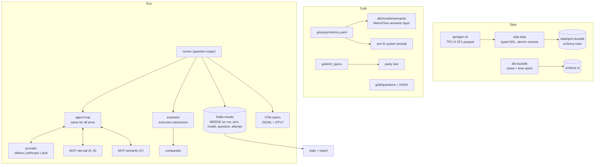

# Arquitetura da solução

[English](architecture.md)

## Componentes

### Caminho de uma tentativa

1. O runner abre um cliente MCP por braço (subprocesso stdio por padrão) e itera
   por pergunta: todos os braços e tentativas de uma pergunta antes da próxima, de modo que deriva de modelo
   ou de máquina afete os braços por igual.
2. O loop envia a pergunta com o system prompt e as tools do braço. As tools de exploração
   vêm do MCP; `submit_sql` / `submit_metric_query` e `refuse` são tools terminais
   controladas pelo harness.
3. Depois de 8 chamadas de exploração, o modelo ganha um último turno só com as tools terminais.
4. O avaliador reexecuta a submissão com a sua própria conexão protegida (o agente
   não consegue influenciar como é avaliado), compara com o resultado de referência e grava a
   linha. Os spans carregam atributos `gen_ai.*` e o score da avaliação.

### Fronteira de segurança

| Camada | Controle | Teste |
|---|---|---|
| Conexão | `read_only=True`, `enable_external_access=false`, auto-install de extensões desligado, depois `lock_configuration=true` | `tests/test_guards.py::TestConnection` |
| Política de SQL | parse com sqlglot: um SELECT/UNION, sem DDL/DML/PRAGMA/SET/ATTACH/COPY, funções de tabela e escalares em deny-list, allow-list de tabelas por braço | 21 casos de rejeição |
| Isolamento entre braços | os braços crus só podem ler as tabelas TPC-H em `main.*`; o SQL compilado do braço semântico só pode ler modelos em `sl.*` | `test_contract.py`, `test_semantic_layer.py` |
| Queries descontroladas | timer de 20 s que chama `interrupt()`; limite de 200 linhas no que o agente vê | `test_timeout_interrupts_runaway_query` |

## Registros de decisão

### ADR-001 TPC-H via tpchgen-cli em vez de TPC-DS

- **Contexto.** O plano usava TPC-DS pela extensão `tpcds` do DuckDB. Extensões são baixadas
  de `extensions.duckdb.org`, que o ambiente de build não conseguia acessar e que
  seria uma dependência de rede em toda execução de CI.
- **Decisão.** TPC-H SF1 gerado pelo `tpchgen-cli` (um pacote do PyPI, determinístico, ~4 s),
  carregado com DDL explícito para que os tipos não variem conforme o gerador.
- **Consequências.** Menos dimensões que o TPC-DS (8 tabelas), então o semantic layer é
  menor. Os nomes de colunas continuam crípticos (`l_extendedprice`), o que mantém o braço A honesto.
  Os dados têm uma peculiaridade que importa para o desenho das perguntas: linhas devolvidas só existem para
  pedidos anteriores a meados de 1995.

### ADR-002 Um loop de agente enxuto em vez de um agent SDK de fornecedor

- **Contexto.** Dois provedores (local e hospedado) precisam ser comparados de forma justa.
- **Decisão.** Um loop neutro em relação a provedor (`agent/loop.py`); os provedores só traduzem
  mensagens. Mesmos limites, prompt e tools terminais em todo lugar.
- **Consequências.** Nenhuma diferença de acurácia entre provedores ou braços pode vir
  do harness. O trade-off é não exibir um SDK de fornecedor; dá para adicionar um depois como
  braço separado.

### ADR-003 Execution accuracy em vez de LLM como juiz

- **Decisão.** Avaliar executando a submissão e comparando os conjuntos de resultado.
- **Por quê.** Um juiz custa tokens, varia entre execuções e tende a aceitar uma resposta bem escrita
  com um número errado. Números são verificáveis, então verifique-os.
- **Regras do comparador** (todas com testes baseados em propriedades): multiconjunto de linhas, a não ser que a pergunta seja
  ordenada; nomes e ordem de colunas ignorados; colunas extras toleradas, colunas faltando não;
  tolerância relativa 1e-4; timestamp à meia-noite ≡ data; ano inteiro ≡ data de 1º de janeiro;
  NULL = NULL.

### ADR-004 Traces em JSONL local mais OTLP opcional (Phoenix), não MLflow

- **Contexto.** O plano propunha MLflow Tracing, com um spike para validar a ingestão OTLP dele.
- **Decisão.** Os spans sempre vão para `runs/<run_id>/spans.jsonl` e, quando
  `OTEL_EXPORTER_OTLP_ENDPOINT` está definido, para um coletor OTLP/HTTP. O docker-compose traz
  o Phoenix, que aceita OTLP nativamente.
- **Consequências.** Os traces existem sem nenhum backend, e o teste e2e verifica que o `trace_id`
  de toda linha de resultado está no arquivo de traces. O MLflow pode ser apontado para o mesmo endpoint OTLP
  depois, se a ingestão dele for validada.

### ADR-005 MetricFlow só como compilador

- **Contexto.** O adapter dbt do MetricFlow abre o arquivo DuckDB em modo leitura e escrita, o que
  conflita com a conexão read-only no mesmo processo.
- **Decisão.** O MetricFlow roda contra um target dbt apoiado em um DuckDB em memória
  (`compile` em `dbt/profiles.yml`) e só produz SQL. Os qualificadores de catálogo são removidos,
  e o SQL passa pela mesma conexão protegida e por uma política de tabelas só semântica.
- **Consequências.** O braço C tem a mesma fronteira de segurança de A e B, e a avaliação percorre o
  mesmo caminho de código que o agente usou.

### ADR-006 Tabela de resultados Delta sem particionamento

- **Decisão.** Tabela delta-rs, `MERGE` em `(run_id, arm, model_id, question_id, attempt)`,
  com flush a cada 10 tentativas.
- **Por que sem partições.** Uma execução completa tem cerca de 2,7k linhas. Particionar por execução ou data
  só criaria arquivos pequenos. Rever acima de ~10⁶ linhas.
- **Consequências.** Rodar de novo não faz nada, uma execução morta retoma de onde o último commit
  terminou (testado com `kill -9`), e a tabela pode ser lida por qualquer engine Delta.

### ADR-007 Proveniência do gold set

- **Os fatos, sem rodeios.** O glossário veio primeiro. Quatro agentes autores independentes escreveram
  as 150 perguntas e o SQL de referência a partir do glossário e do schema cru, sem
  acesso a nenhuma spec de MetricFlow. Enquanto eles trabalhavam, o YAML do semantic layer foi escrito
  a partir do glossário por outro autor, que não leu as perguntas. O gold set
  foi validado e congelado (commit `feat(slab): freeze gold set ...`) antes de existir qualquer spec de MetricFlow por pergunta.
  As specs foram então escritas por pergunta e precisam reproduzir o resultado de referência
  exatamente (`parity: 130/130`).
- **Risco residual.** Todos os autores tiveram assistência de IA e trabalharam a partir do mesmo glossário.
  Uma extensão do holdout escrita por humanos é a melhor forma de reduzir isso ainda mais.
