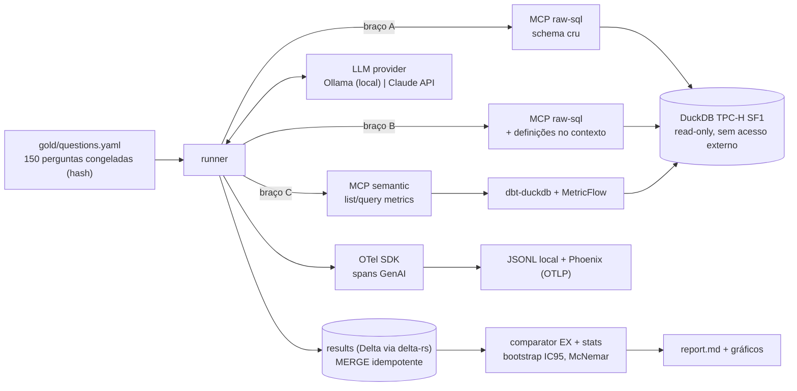

# Semantic Layer Agent Bench: plano de desenvolvimento e teste

> **TLDR.** O experimento mede se um semantic layer aumenta a acurácia de um agente
> text-to-SQL, ou se documentação boa do schema já entrega o mesmo ganho. São
> 150 perguntas congeladas, três braços (schema cru, schema documentado, semantic
> layer), dois modelos e três repetições, com execution accuracy, IC 95% e McNemar.
> Roda local com um comando e custo zero de cloud, como o resto do portfólio.
> São 6 sprints de 1 semana (09/nov a 20/dez/2026), com 6 a 8 h por semana.

> **Status em 05/nov/2026.** S0 a S3 estão implementados e testados: dados, gold set
> congelado (150 perguntas, hash `2b8663f4…`), semantic layer com paridade 130/130, MCP
> servers, loop do agente, runner resumível, store Delta, estatística, relatório, CI e
> 83 testes. **Ainda não existe nenhum resultado com modelo real.** S4 (rodar Ollama e
> Claude) e S5 (README com números) dependem de GPU/Ollama e de chave da API, que não
> estavam disponíveis no ambiente de build.

---

## 1. Pergunta, hipóteses e o que muda em relação à ideia original

**Pergunta.** Dar a um agente acesso a métricas governadas (semantic layer) melhora
a acurácia em relação a SQL livre? O ganho vem da *camada* ou da *documentação das
regras de negócio* que vem junto com ela?

| # | Hipótese | Como é medida |
|---|---|---|
| H1 | Braço C (semantic layer) > braço A (schema cru) em execution accuracy (EX) | EX por braço, McNemar pareado A×C |
| H2 | Braço B (schema cru + definições de métrica em texto no contexto) captura a maior parte do ganho de C | Razão (B−A)/(C−A) com IC por bootstrap |
| H3 | O ganho de C sobre A é maior em modelo pequeno local do que em modelo frontier | Interação braço × modelo |
| H4 | C reduz a variância entre repetições da mesma pergunta | pass^3 (as 3 tentativas corretas) por braço |
| H5 | C perde em perguntas fora da cobertura modelada | EX e recusa correta na categoria `out_of_coverage` |

**O braço B é o centro do experimento.** Os benchmarks públicos que encontrei, quase
todos de vendor, comparam só A contra C e mudam duas variáveis ao mesmo tempo. Sem o
braço B, não dá para atribuir o ganho à camada.

**Mudanças de escopo em relação ao "Agentic Data Steward" (e por quê):**

- **Saiu a triagem de falhas de pipeline.** Ela se sobrepõe ao *Autonomous SRE
  Agent*, que já está no portfólio. Dois projetos provando a mesma coisa diluem a
  mensagem.
- **Saiu o Lakebase/Unity Catalog do caminho crítico.** O README promete que todo
  projeto roda local, com custo zero de cloud e um comando Docker. Um projeto
  dependente de workspace pago quebraria essa promessa e a reprodutibilidade por
  terceiros.
- **Databricks Metric Views virou stretch goal** (braço C′), útil para a Databricks
  Pro, mas fora do caminho crítico.

---

## 2. Arquitetura



### Decisões e trade-offs

| Decisão | Alternativa descartada | Porquê |
|---|---|---|
| **TPC-H SF1 via `tpchgen-cli` em DuckDB** (era TPC-DS, ver ADR-001 em `docs/architecture.md`) | TPC-DS via extensão do DuckDB, Spider/BIRD | A extensão `tpcds` baixa de `extensions.duckdb.org`, uma dependência de rede que falhou no ambiente de build e seria frágil no CI. O `tpchgen-cli` é pacote PyPI, determinístico e gera SF1 em ~4 s. Os nomes crípticos (`l_extendedprice`) mantêm o braço A honesto. O custo é ter menos dimensões que o TPC-DS |
| **MetricFlow (Apache 2.0) + dbt-duckdb** | Cube, Metric Views | É OSS, roda local, exporta para OSI e é o semantic layer mais citado para agentes. Metric Views fica como stretch |
| **Loop de agente próprio e fino**, com o mesmo loop para os dois providers | Claude Agent SDK | **Justiça do experimento.** Com SDK num provider e outro loop no outro, a diferença viraria efeito do harness. O custo é mostrar menos o Agent SDK. O SDK pode entrar como braço extra depois |
| **Execution accuracy determinística** | LLM-as-judge | Judge custa token, varia entre execuções e aceita resposta bem escrita com número errado. Correção de número é verificável por execução |
| **MCP read-only por domínio** (`raw-sql`, `semantic`) | Um server com tudo | Cada braço vê só as tools dele, o blast radius fica pequeno e o isolamento entre braços é garantido |
| **Delta via delta-rs, sem particionamento** | Particionar por `run_date` | O volume é de alguns milhares de linhas por run. Particionar só geraria small files. Se passar de ~10⁶ linhas, reavaliar |
| **OTel GenAI → JSONL local + Phoenix** (era MLflow, ver ADR-004) | MLflow Tracing | É o padrão que está convergindo. Os spans vão sempre para um JSONL local (o teste confere o `trace_id` de cada linha) e, opcionalmente, para o Phoenix, que tem OTLP nativo. O OTLP do MLflow não foi validado neste ambiente |

### Parâmetros fixos do agente (iguais em todos os braços)

- Temperatura 0, máximo de 8 tool calls, timeout de 60 s por pergunta e 3 repetições por pergunta.
- System prompt idêntico em todos os braços. Só mudam as tools expostas e, no braço B, o bloco de definições.
- Cada run registra `model_id` e digest/versão, `git_sha` e o hash do gold set.

---

## 3. Gold set

**Composição (150 perguntas):**

| Categoria | Qtd | Exemplo |
|---|---|---|
| `simple` | 40 | Total de vendas por loja em 2001 |
| `multi_join` | 40 | Receita por categoria e faixa de renda do cliente |
| `time` | 25 | Crescimento YoY de vendas web por trimestre |
| `business_definition` | 25 | Receita líquida (vendas − devoluções) por estado |
| `out_of_coverage` | 20 | Perguntas que o semantic layer não cobre, em que o certo é recusar ou dizer que não há métrica |

**Regras anti-viés (são as que dão credibilidade ao resultado):**

1. **Escrever as perguntas antes de modelar qualquer métrica.** Na S1 o arquivo é
   congelado e o hash (SHA-256) vai para o commit e para cada run. Modelar olhando as
   perguntas faria o semantic layer ganhar por construção.
2. **Split `dev` (50) / `holdout` (100), estratificado por categoria e definido por hash do id.** Iteração de
   prompt só no `dev`. O número publicado é o do `holdout`. O holdout é maior que o
   dev de propósito, porque é ele que precisa de poder estatístico.
3. **Contaminação.** As 22 queries oficiais do TPC-H são públicas e os modelos já
   viram esse schema. As perguntas são escritas do zero, e um subset roda com schema
   renomeado (`l_extendedprice` → `c_017`) para medir o efeito de memorização (roadmap, ainda não implementado).

**Formato (ilustrativo):**

```yaml
- id: q017
  category: business_definition
  split: holdout
  question: "Qual foi a receita líquida por estado em 2002, descontando devoluções?"
  reference_sql: sql/q017.sql
  mf_spec:                       # usado só no teste de paridade, nunca pelo agente
    metrics: [net_revenue]
    group_by: [customer__state]
    where: ["metric_time__year = 2002"]
  order_matters: false
  expected_outcome: answer       # answer | refuse
```

---

## 4. Estrutura do repo

```
semantic-layer-agent-bench/
├── docker-compose.yml     # init de dados, ollama, mlflow, otel-collector
├── Makefile               # data | gold-check | parity | test | smoke | bench | report
├── dbt/                   # dbt-duckdb + semantic_models + metrics + time spine
├── gold/                  # questions.yaml, sql/, HASH
├── servers/
│   ├── raw_sql/           # MCP: list_tables, describe_table, run_sql
│   └── semantic/          # MCP: list_metrics, list_dimensions, query_metrics
├── agent/                 # loop, providers/{ollama,anthropic,stub}, prompts/
├── harness/               # runner, comparator, store (delta), stats, report
├── tests/                 # unit, gold, parity, contract, e2e
└── docs/                  # business-case, srs-29148, architecture, acceptance (EN + PT-BR)
```

---

## 5. Cronograma (6 a 8 h por semana)

| Sprint | Datas | Entrega | Pronto quando |
|---|---|---|---|
| **S0** | 09–15/nov | Pacote de requisitos (business case, SRS 29148 enxuto, arquitetura, plano de aceite). Skeleton do repo, compose, `make data` gerando TPC-H SF1 | `docker compose up && make data` sobe limpo numa máquina zerada |
| **S1** | 16–22/nov | 150 perguntas + SQL de referência, validador do gold, **hash congelado**. Depois disso, modelagem MetricFlow (semantic models, métricas, time spine) | `make gold-check` e `make parity` 100% verdes |
| **S2** | 23–29/nov | MCP servers `raw-sql` e `semantic` com guards de segurança. Testes unitários e de contrato | Suíte de guards verde, incluindo as tentativas de escape |
| **S3** | 30/nov–06/dez | Loop do agente com providers (Ollama, Claude, stub), runner com os 3 braços, tracing, store Delta, comparator | `make smoke` (stub LLM, 10 perguntas) verde no CI em menos de 10 min |
| **S4** | 07–13/dez | Runs completos (2 modelos × 3 braços × 150 × 3), stats, taxonomia de erros e análise manual de cerca de 30 falhas | `report.md` gerado só a partir dos dados, sem número digitado à mão |
| **S5** | 14–20/dez | README EN + PT-BR com a saída real colada, gráficos, aceite formal e post de resultados | Todos os critérios da seção 7 marcados |

**Buffer.** A data da prova da CCA-P (alvo nov/26) cai provavelmente na S1 ou na S2.
A semana da prova vira buffer e o cronograma desliza uma semana sem cortar escopo. Se
precisar cortar, o corte é o braço C′ e o subset de schema renomeado, nunca o braço B
nem o holdout.

---

## 6. Estratégia de testes

### 6.1 Unitários (pytest + hypothesis)

**Comparator (EX).** É a peça mais crítica, porque um bug aqui invalida tudo.
- Comparação como multiconjunto de linhas, independente da ordem, a não ser que `order_matters`.
- Casamento de colunas por assinatura de valores, sem depender de nome ou alias.
- Tolerância numérica relativa de 1e-4, para lidar com `DECIMAL` versus `DOUBLE` e arredondamento.
- NULL tratado como valor igual a NULL. Resultado vazio só é igual a vazio.
- **Testes de propriedade:** permutar linhas ou colunas não muda o veredito. Perturbar um valor acima da tolerância muda.

**Guards de SQL (`raw-sql`)**
- Parse com `sqlglot`, aceitando só uma instrução `SELECT`/`WITH`. Rejeita DDL, DML, `ATTACH`, `COPY`, `PRAGMA`, `SET`, `INSTALL`/`LOAD` e múltiplas instruções.
- **Gotcha:** conexão `read_only=True` não impede `read_csv('/etc/passwd')`. Por isso o servidor aplica `SET enable_external_access = false` e, em seguida, `SET lock_configuration = true`, para o agente não conseguir religar. Há teste explícito de cada vetor.
- O DuckDB não tem statement timeout nativo, então o timeout é feito com `con.interrupt()` disparado por timer. O teste usa uma query cartesiana proposital.
- `LIMIT` máximo injetado e truncamento sinalizado ao agente, para que ele não "veja" 10⁶ linhas.

**`query_metrics` (`semantic`):** métrica ou dimensão inexistente retorna erro estruturado, não exception.

### 6.2 Gold set e paridade

- `gold-check`: todo SQL de referência executa, é determinístico (duas execuções dão o mesmo resultado), não volta vazio (a não ser os marcados) e o schema YAML é validado por pydantic. Também checa o balanceamento por categoria e o hash conferindo com `gold/HASH`.
- **`parity` (obrigatório antes de qualquer run):** para cada pergunta in-coverage, o resultado do `mf_spec` via MetricFlow é igual ao resultado do SQL de referência pelo comparator. Isso garante que o braço C não seja punido por bug de modelagem meu.

### 6.3 Contrato MCP

- Snapshot dos schemas das tools por servidor, para que uma mudança acidental de interface quebre o teste.
- Cliente MCP in-process chama cada tool com payload válido e inválido.
- **Isolamento entre braços:** o runner do braço A não consegue listar tools do `semantic`, e vice-versa.

### 6.4 End-to-end

- **`make smoke` com provider `stub`.** O stub replica tool calls roteirizadas: 10 perguntas, com 7 respostas certas e 3 erradas de propósito. O teste espera exatamente EX = 70% e valida o pipeline inteiro (runner → MCP → DuckDB → store → comparator → report) sem LLM, ou seja, é determinístico e roda grátis no GitHub Actions.
- **Idempotência:** rodar de novo o mesmo `run_id` não altera a contagem de linhas. A chave do `MERGE` é `(run_id, arm, model_id, question_id, attempt)`.
- **Crash/resume:** um `kill -9` no meio do run seguido de restart completa o run sem duplicata e sem buraco.
- **Tracing:** cada linha de resultado tem um `trace_id` que existe no backend de traces, e cada trace tem spans de LLM e de tool.

### 6.5 Validade estatística

- **Teste A/A:** o mesmo braço rodado duas vezes não pode dar McNemar significativo. Se der, há viés ou instabilidade no harness.
- IC 95% por bootstrap, com reamostragem por pergunta (não por tentativa, porque as tentativas da mesma pergunta não são independentes).
- **Poder:** com n = 100 no holdout, diferenças abaixo de cerca de 10 a 15 pp provavelmente não serão significativas (depende do número de pares discordantes). O README reporta isso em vez de forçar uma conclusão.

### 6.6 Custo

- Tokens de entrada e saída e a latência ficam em cada linha.
- O preço por modelo fica em config, não no código. O runner estima o custo antes de começar e **aborta se passar do teto** (`BUDGET_USD`).
- A ordem dos runs é: Ollama completo (grátis), Claude no `dev` com 1 repetição para calibrar o custo e só então Claude no holdout com 3 repetições.

---

## 7. Plano de aceite

- [ ] `docker compose up` seguido de `make bench MODEL=ollama:<modelo>` roda ponta a ponta numa máquina limpa, sem nenhuma credencial de cloud
- [ ] `gold-check` e `parity` 100% verdes, com o hash do gold set igual ao do commit de congelamento
- [ ] Suíte de guards cobre todos os vetores listados em 6.1
- [ ] CI (stub) verde em menos de 10 min
- [ ] Teste A/A sem diferença significativa
- [ ] Resultados de 2 modelos × 3 braços × 3 repetições no holdout, com IC 95% e McNemar par a par
- [ ] Taxonomia de erros com exemplos reais: join errado, filtro errado, definição de métrica errada, grão de tempo errado, coluna alucinada, erro de protocolo de tool, recusa indevida
- [ ] README EN + PT-BR com a saída real colada, incluindo o que **não** deu para concluir
- [ ] Pacote de requisitos em `docs/`, nos dois idiomas

---

## 8. Riscos

| Risco | Prob. | Impacto | Mitigação |
|---|---|---|---|
| Modelo local com tool calling ruim domina os erros | Alta | Médio | Medir a taxa de "erro de protocolo de tool" separada da EX. Testar 2 modelos locais na S3 e escolher o mais estável |
| Gold set enviesado a favor do semantic layer | Média | Alto | Congelar as perguntas antes de modelar, usar holdout e publicar o gold set |
| Contaminação (modelos conhecem TPC-H) | Alta | Médio | Perguntas escritas do zero e subset com schema renomeado |
| Custo da API do Claude estoura | Baixa | Baixo | Teto `BUDGET_USD`, calibração no dev e subset antes do completo |
| OTLP no MLflow não atende | Média | Baixo | Resolvido: Phoenix + JSONL local (ADR-004) |
| Resultado "nulo" (B ≈ C) | Média | **Nenhum** | É um resultado publicável, e provavelmente o mais interessante |
| Agenda (CCA-P, pós, dois empregos) | Alta | Médio | Buffer explícito e a ordem de corte da seção 5 |

---

## 9. Calendário de conteúdo

| Quando | Post | Ângulo |
|---|---|---|
| Esta semana | Kickoff: pergunta e desenho do experimento (`linkedin-post.md`) | trade-off, gotcha ou "como eu faço" |
| Início de dez (S3) | Gotcha real encontrado na implementação (por exemplo `read_only` sem `enable_external_access`) | gotcha |
| **06 a 08/jan/2027** | Resultados com IC e a imagem atualizada com as barras reais | trade-off |

O post de resultados fica fora da última semana de dezembro, porque o alcance no
LinkedIn cai muito entre o Natal e o Ano-Novo.
